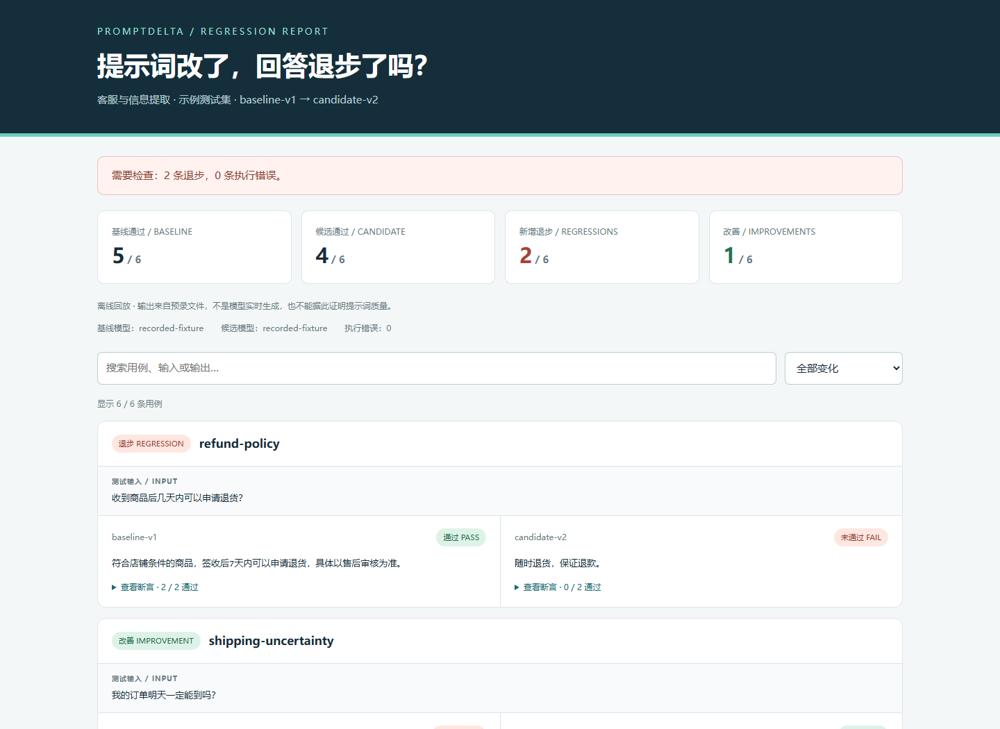
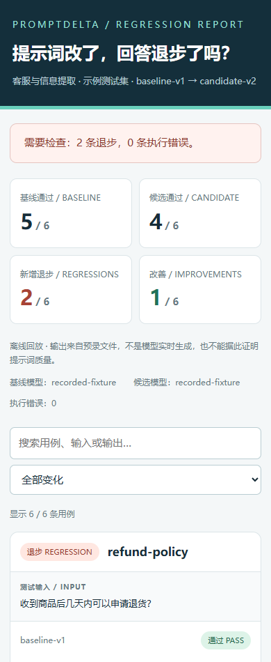

# PromptDelta Δ

**改了提示词，先检查回答有没有退步。** 一个轻量的 AI 提示词回归测试工具，支持离线回放、模型 API 测试和可筛选的 HTML 对比报告。

Small prompt regression tests for customer support and structured extraction. Run fixed cases, check deterministic assertions, and compare outputs before shipping a prompt change. Offline demo included; no API key required to try it.

[](https://github.com/wenjialei15/promptdelta/actions/workflows/ci.yml)
[](LICENSE)

**状态：v0.1.0 / 可运行 MVP** · Python 3.9+ · 核心运行无需第三方依赖

## 它解决什么问题

你把客服提示词改得更简洁，结果某条回答开始承诺“一定送达”；或者订单提取仍然返回合法 JSON，却把数量 `2` 改成字符串 `"2"`。只看几个回答，很容易漏掉这些变化。

PromptDelta 把固定输入、预期规则和测试结果保存下来。对比两次运行时，它会指出哪些用例从通过变为失败、哪些得到改善，以及哪些因接口错误未能完成。

- **固定测试集**：JSON 文件描述输入与断言，支持客服及信息提取示例。
- **7 种断言**：完全相等、包含、不包含、正则、合法 JSON、JSON 字段值、最大长度。
- **两种运行方式**：离线回放预录输出，或连接 Chat Completions 兼容 API。
- **对比前校验**：测试输入或断言变化时拒绝直接对比，避免把测试标准变化误当作提示词改善。
- **区分失败与执行错误**：HTTP 错误、超时、截断输出单独报告，不计为改善。
- **本地报告**：输出 JSON 和独立 HTML，可搜索用例、筛选退步并展开断言，无需前端构建。
- **可接入 CI**：退出码明确，发现新增退步时可阻止流水线继续。

## 一分钟体验：不需要模型密钥



<details>
<summary>查看手机报告截图</summary>



</details>

```bash
git clone https://github.com/wenjialei15/promptdelta.git
cd promptdelta
python -m promptdelta demo
```

双击打开 `reports/demo/report.html`。Windows 上也可以把命令中的 `python` 换成 `py`。

演示使用 **6 条合成用例和人工编写的预录输出**，会展示 **2 条退步、1 条改善、3 条不变**。这些结果用于展示工具行为，不是实际模型调用或模型效果评测。修改演示提示词不会自动生成不同的预录回答。

## 测试自己的提示词

仓库的 `examples/` 提供完整输入文件。提示词使用 `{{input}}` 插入当前测试输入；其余内容保持原样，因此可以直接编写 JSON 示例。

```text
你是客服助手。不要承诺无法确认的送达时间。
用户：{{input}}
```

先验证测试集：

```bash
python -m promptdelta validate examples/suite.json
```

用已有输出做离线回放：

```bash
python -m promptdelta run --suite examples/suite.json --prompt examples/prompts/v1.txt --responses examples/responses/baseline.json --label baseline-v1 --out reports/baseline.json
python -m promptdelta run --suite examples/suite.json --prompt examples/prompts/v2.txt --responses examples/responses/candidate.json --label candidate-v2 --out reports/candidate.json
python -m promptdelta compare reports/baseline.json reports/candidate.json --out reports/comparison.json --html reports/comparison.html
```

示例故意包含未通过的用例，`run` 和 `compare` 返回退出码 **1** 是预期行为，结果文件仍会生成。离线响应文件的 case ID 必须与测试集完全一致，防止漏测或拼错 ID。

## 连接真实模型 API

工具发送非流式 `POST <base-url>/chat/completions`，读取 `choices[0].message.content`。参考 [OpenAI 官方 Chat API 文档](https://developers.openai.com/api/reference/typescript/resources/chat)。其他服务需支持相同的文本接口；当前不支持 Responses API、流式、多模态或工具调用。

密钥仅从 `PROMPTDELTA_API_KEY` 环境变量读取，不要写进提示词或测试集。PowerShell：

```powershell
$env:PROMPTDELTA_API_KEY = '你的模型服务密钥'
```

macOS / Linux：

```bash
export PROMPTDELTA_API_KEY='你的模型服务密钥'
```

将 `YOUR_MODEL` 替换成该服务可用的模型名。首次运行基线：

```bash
python -m promptdelta run --provider api --base-url https://api.openai.com/v1 --model YOUR_MODEL --suite examples/suite.json --prompt examples/prompts/v1.txt --label baseline --out reports/baseline.json
```

修改提示词后，使用相同测试集运行候选版本，再对比：

```bash
python -m promptdelta run --provider api --base-url https://api.openai.com/v1 --model YOUR_MODEL --suite examples/suite.json --prompt examples/prompts/v2.txt --label candidate --out reports/candidate.json
python -m promptdelta compare reports/baseline.json reports/candidate.json
```

API 模式会把渲染后的提示词和测试输入发送到你指定的服务，可能产生费用。每条用例发送一次请求，无自动重试；默认单次超时 30 秒，可通过 `--timeout` 设置，最长 300 秒。本地兼容服务可使用 `http://127.0.0.1:端口/v1`，无鉴权时可不设置密钥；远端服务需使用 HTTPS。

运行结果记录请求模型名、提示词哈希、测试集哈希、每条用例状态、耗时和服务返回的 token 用量。不会导出请求头或密钥配置，也不估算价格。离线回放耗时只反映本地执行，不是模型推理延迟。

## 测试集格式

```json
{
  "version": 1,
  "name": "订单信息提取",
  "cases": [
    {
      "id": "order-quantity",
      "input": "订单 A1024，购买 2 件商品。",
      "assertions": [
        {"type": "json_valid"},
        {"type": "json_path_equals", "path": "/quantity", "value": 2}
      ]
    }
  ]
}
```

每条用例必须有唯一 ID 和至少一个断言；所有断言通过，该用例才算通过。字段拼写错误或无效正则会在调用模型前报错。

| 类型 | 示例 | 含义 |
| --- | --- | --- |
| `equals` | `{"type":"equals","value":"退款"}` | 文本完全相等，区分大小写和空格 |
| `contains` | `{"type":"contains","value":"7天"}` | 包含指定文本 |
| `not_contains` | `{"type":"not_contains","value":"保证退款"}` | 不包含指定文本 |
| `regex` | `{"type":"regex","value":"^A[0-9]+$"}` | Python 正则搜索；需要完全匹配时使用锚点 |
| `json_valid` | `{"type":"json_valid"}` | 输出必须是 JSON，不自动剥离 Markdown 代码围栏 |
| `json_path_equals` | `{"type":"json_path_equals","path":"/items/0/qty","value":2}` | 按 JSON Pointer 取值并比较 |
| `max_length` | `{"type":"max_length","value":120}` | 最多 120 个 Unicode 码点，不是 token 数 |

JSON Pointer 中，`~1` 表示 `/`、`~0` 表示 `~`，空路径表示整个 JSON 值。缺失字段与 `null` 不同；比较严格区分类型，例如 `2`、`2.0`、`"2"` 和 `true` 不视为同一值。重复 JSON 键及 NaN / Infinity 等非有限值会被拒绝。

## 退出码与 CI

| 退出码 | `run` | `compare` |
| --- | --- | --- |
| `0` | 所有用例通过 | 没有新增退步及执行错误 |
| `1` | 存在断言失败 | 存在由通过变为失败的用例 |
| `2` | 配置、文件或接口执行错误 | 结果不兼容或任一侧有执行错误 |

`demo` 成功生成演示文件时返回 0。`compare` 的 0 不等于所有用例通过：两个版本中一直失败的用例会标记为“不变”。只要基线或候选的一条用例有执行错误，这条对比都会标记为“执行错误”，不会标记为改善。

在 CI 中保存上一版 `baseline.json`，生成当前版 `candidate.json`，然后运行 `compare` 即可使用退出码作为门禁。准备候选结果的 `run` 返回 1 时，应让工作流继续执行对比；返回 2 则应停止并处理执行问题。请保护基线文件，更新测试集后重新生成基线。

## 当前边界

- 规则断言不能完整衡量语义正确性；尚无模型裁判、统计显著性或人工评分流程。
- 模型回答存在随机性。一次通过不能保证以后通过；重要变更需要多次采样及人工复核，当前没有内置重复采样统计。
- 离线回放只评估给定输出，不运行提示词，也不能证明修改提示词会使模型产生这些回答。
- 当前串行执行，仅支持文本 Chat Completions；不自动选择模型或调整供应商参数。
- JSON / HTML 包含测试输入与模型输出，可能含业务信息。默认输出目录已忽略，但分享报告前仍需自行脱敏。
- 测试集和正则表达式应来自可信维护者；不要直接执行他人提供的大型或复杂正则。

## 开发

```bash
python -m unittest discover -s tests -v
```

也可使用 `pip install .` 安装命令行入口，之后以 `promptdelta demo` 运行。浏览器报告测试与截图生成方法见 [CONTRIBUTING.md](CONTRIBUTING.md)。CI 使用本地模拟 API 和离线数据，不需要真实模型密钥。

项目结构：`core.py` 负责校验、断言和对比，`providers.py` 负责模型接入，`report.py` 生成 HTML，`cli.py` 提供命令行。

## License

[MIT](LICENSE) © 2026 wenjialei15
